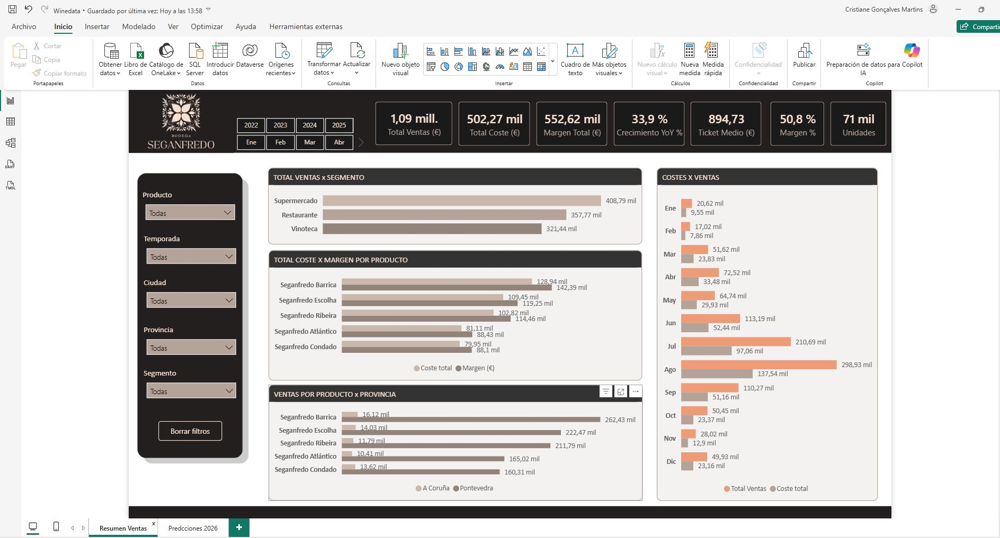

# PROYECTO WINEDATA

Proyecto de datos end-to-end desarrollado como Proyecto Fin de Ciclo del Grado Superior en Desarrollo de Aplicaciones Web (DAW).
WineData simula el ecosistema de datos de una bodega gallega, cubriendo todo el ciclo de vida de la información: extracción de datos de un ERP, procesos ETL, diseño de un Data Warehouse, modelado dimensional, análisis de datos y visualización en Power BI.

El proyecto incluye un proceso completo de integración, transformación y explotación de datos orientado a la toma de decisiones empresariales.

El objetivo del proyecto es transformar datos operacionales en información analítica que permita evaluar el rendimiento comercial de la bodega y apoyar la toma de decisiones basada en datos.

Proyecto presentado y aprobado en mayo/2026 | Calificación: 90/100.  
🎥 Haz clic en la imagen para ver la demostración del dashboard en YouTube.  

## HERRAMIENTAS Y TECNOLOGÍAS

### Datos y Bases de Datos   
· MySQL    
· MariaDB    
· SQL    
· MySQL Workbench     
 
### ETL e Integración  
· Python   
· Pandas   
 
### Data Warehouse   
· Star Schema   
· Modelado dimensional   
 
### Analítica y Visualización  
· Power BI   
· Microsoft Fabric   
 
### Machine Learning  
· Scikit-learn   
· Random Forest   
 
### Desarrollo y Gestión  
· Git   
· GitHub   
· VS Code   
· Scrum   
· Trello   

## Competencias desarrolladas  

· Diseño de Data Warehouse (Star Schema)  
· Procesos ETL  
· Modelado dimensional  
· Integración de datos  
· SQL y bases de datos relacionales  
· Limpieza y transformación de datos  
· Análisis de datos  
· Visualización de KPIs  
· Machine Learning aplicado a negocio  
· Gestión de proyectos con Git y Scrum  

## Arquitectura de la solución   

Microsoft Dynamics 365 Business Central  
            ↓
       Staging Area
            ↓
          ETL
            ↓
     Data Warehouse
            ↓
    Machine Learning
            ↓
        Power BI

## PROCESO ETL  
Scripts de preparación  
· `create_staging_tables.sql`: crea las tablas de staging en MySQL.  
· `create_dw_tables.sql`: crea el esquema del Data Warehouse en estrella.  
  
1. Extracción   
· `load_staging.py`: carga los archivos CSV — que simulan el export del ERP Microsoft Business Central — en las tablas de staging, sin ninguna transformación.  

2. Transformación y carga:  
· `etl_winedata.py`: lee los datos crudos de staging, aplica limpieza y normalización, calcula métricas de negocio (margen, coste, rentabilidad) y carga los datos transformados en las tablas dimensionales y de hechos del Data Warehouse.  

Alternativa de conexión Power BI:  
· `export_dw_to_csv.py`: exporta las 5 tablas del DW a CSV cuando la conexión directa MySQL no está disponible.  

## DATA WAREHOUSE (DW)    

· `create_dw_tables.sql`: crea la estructura del Data Warehouse  — base de datos, tablas, relaciones e índices.  

El DW está diseñado siguiendo un modelo en estrella (star schema):  
· Tabla de hechos: hechos_ventas  
· Tablas de dimensiones: dim_cliente, dim_producto, dim_vendedor, dim_calendario   

El script SQL incluye:  
· Creación de la base de datos winedata_dw  
· Creación de tablas con tipos de datos correctos  
· Foreign keys entre hechos y dimensiones  
· Índices para optimizar las consultas de Power BI   

### PREDICCIONES CON MACHINE LEARNING  

- `ml_predicciones.py`: El script implementa un modelo de predicción basado en scikit-learn.  

· Modelo: Random Forest Regressor  
· Entrenamiento: 2022-2024 · Validación: 2025   

Incluye:  
· Preparación del dataset   
· División train/test  
· Entrenamiento del modelo  
· Evaluación  
· Generación de predicciones finales  

Las predicciones se integran posteriormente en Power BI para visualización.   

## ANÁLISIS Y VISUALIZACIÓN DE DATOS    

El proyecto incluye capturas del dashboard final, donde se muestran:   
· Tendencias de ventas  
· Predicciones generadas por el modelo ML  
· Análisis por cliente, producto y categoría  

## REQUISITOS   

# Python  
· Python 3.10+  
· pandas  
· numpy  
· scikit-learn  
· mysql-connector-python  

# Base de datos  
· MySQL / MariaDB  
· XAMPP (como servidor local)  
· MySQL Workbench (gestión visual)  

# Conector  
· MySQL Connector/NET 8.0.28 (específico para compatibilidad con Power BI y MariaDB vía XAMPP)  

# Visualización  
· Power BI Desktop  
· Microsoft Fabric (publicación del dashboard)  

# Control de versiones  
· Git   
· GitHub  

# Entorno de desarrollo  
· VS Code  

# Gestión del proyecto  
· Trello  

## FLUJO DEL PROYECTO    

ERP (BC) → Staging Area → ETL → Data Warehouse → Machine Learning → Power BI   

* El ML va después del Data Warehouse porque el modelo se alimenta de los datos ya limpios y transformados que están en winedata_dw.
Las predicciones generadas se guardan de vuelta en el DW en la tabla predicciones_ventas, antes de llegar a Power BI.
